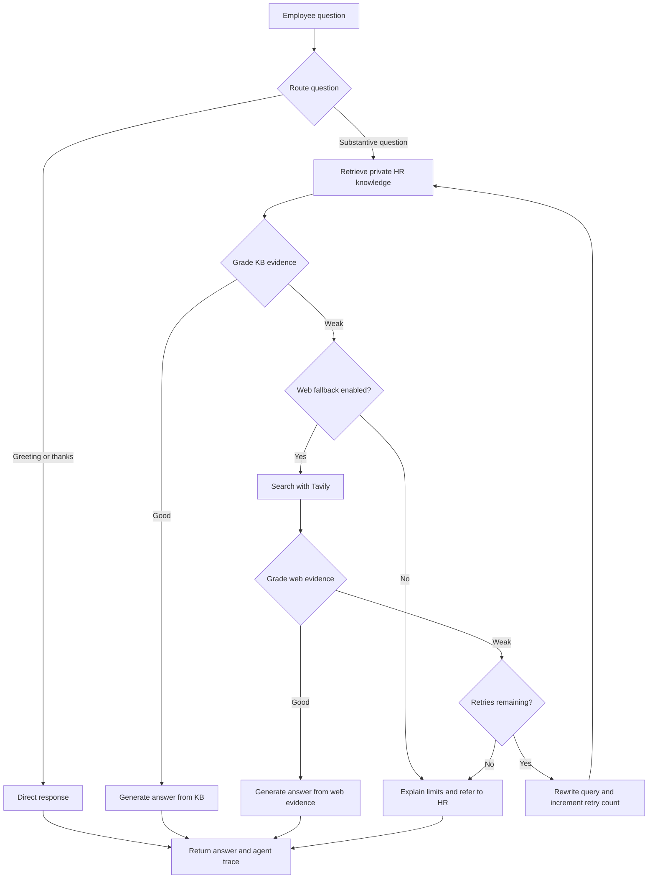

# HR Support RAG Copilot

An HR support assistant built with FastAPI, LangGraph, Groq, Pinecone, and Tavily.

I built this project to explore how an assistant can answer employee questions using company documents, check whether the retrieved information is useful, and search outside the knowledge base only when necessary. The focus is on making the answer’s source and the agent’s decisions visible.

The copilot covers questions about leave, benefits, payroll processes, onboarding, offboarding, and other HR policies. It searches the private knowledge base first, evaluates the evidence, and falls back to Tavily when the internal context is insufficient.

> The included HR policies are fictional demo documents. This project does not connect to an HRIS or access personal employee records.

## Features

- **Private knowledge retrieval:** Semantic search over HR documents stored in a Pinecone namespace.
- **Evidence grading:** LLM-based checks before generating a KB or web answer.
- **Conditional web search:** Tavily fallback after weak private-KB evidence.
- **Query refinement:** A bounded retry loop that rewrites the query and starts again from private retrieval.
- **Source visibility:** Document references for KB answers and links for web answers.
- **Agent trace:** A readable record of routing, retrieval, grading, and generation decisions.
- **Document ingestion:** Upload PDF, TXT, Markdown, or DOCX files using an admin API key.
- **Responsive chat UI:** A scrollable conversation area, suggested questions, and an agent activity panel.
- **Audit logging:** SQLite storage for questions, source labels, timestamps, and traces.

## How it works

The workflow is defined in [`app/rag/workflow.py`](app/rag/workflow.py).



A good web result goes to answer generation and then output. It does **not** go through the retry loop. With the default `MAX_RETRIES=1`, weak web evidence can trigger one additional KB-first retrieval cycle.

Routing and evidence grades are model decisions, not guarantees that an answer is correct. The answer prompts instruct the model to distinguish external guidance from internal policy and to avoid inventing employee entitlements.

An editable architecture diagram is available at [`output/diagrams/hr-support-rag-architecture.drawio`](output/diagrams/hr-support-rag-architecture.drawio). Open it in diagrams.net to adjust its layout, labels, and connectors. The Mermaid diagram above documents the application’s control flow.

## Tech stack

| Component | Implementation |
| --- | --- |
| Backend | Python 3.11+, FastAPI, Uvicorn |
| Workflow | LangGraph |
| Language model | Groq via `ChatGroq` |
| Default model | `openai/gpt-oss-20b` served through Groq |
| Embeddings | Local Hugging Face `sentence-transformers/all-MiniLM-L6-v2` |
| Vector database | Pinecone, 384-dimensional vectors for the default embedding model |
| Web search | Tavily |
| Document processing | LangChain loaders, PyPDF, python-docx |
| Frontend | Jinja2, HTML, CSS, vanilla JavaScript |
| Audit storage | SQLite |
| Tests | Python `unittest` |

## Project structure

```text
app/
├── main.py                     # FastAPI app, static files, and homepage
├── api/routes.py               # Chat, ingestion, and health endpoints
├── core/
│   ├── config.py               # Environment settings and defaults
│   └── logging.py              # Logging setup
├── rag/
│   ├── state.py                # Graph state and structured model outputs
│   ├── workflow.py             # Routing, grading, fallback, and retries
│   └── vectorstore.py          # Embeddings and Pinecone integration
└── services/
    ├── ingestion.py            # File loading and text splitting
    └── audit.py                # SQLite audit records
data/sample_kb/
├── hr_handbook.md              # Fictional HR demo policies
└── hr_support_runbook.md       # Fictional HR support procedures
static/
├── css/style.css
└── js/app.js
templates/index.html
tests/test_hr_workflow.py
output/diagrams/                # Editable architecture diagram
.env.example
requirements.txt
ingest_sample_kb.py             # Demo knowledge ingestion
run.py                         # Local development server
```

`demo/Agentic_RAG.ipynb` is an earlier RAG experiment. The web application runs through `run.py`, not the notebook or the root `main.py` greeting script.

## Local setup

### 1. Prepare the environment

Open a terminal in the project directory. Use Python 3.11 or later.

```bash
python3 -m venv .venv
source .venv/bin/activate
python -m pip install -r requirements.txt
```

On Windows PowerShell, activate the environment with:

```powershell
.venv\Scripts\Activate.ps1
```

Use `requirements.txt` for installation; dependencies are not currently populated in `pyproject.toml`.

### 2. Configure the services

Create your local configuration if you do not already have one:

```bash
cp .env.example .env
```

On PowerShell, use `Copy-Item .env.example .env`. Keep existing settings if `.env` is already configured.

Set these values in `.env`:

```dotenv
GROQ_API_KEY=your-groq-api-key
PINECONE_API_KEY=your-pinecone-api-key
TAVILY_API_KEY=your-tavily-api-key
ADMIN_API_KEY=your-own-strong-admin-secret
```

Groq is used for routing, evidence grading, query rewriting, and answer generation. Pinecone stores the knowledge base. Tavily is needed when web fallback runs. There is no OpenAI API key requirement for the default Groq and Hugging Face setup.

The embedding model downloads its weights on first use, so the first ingestion or retrieval can take longer. Provider accounts, network access, permissions, and any applicable API usage costs are separate from this repository.

### 3. Index the demo documents

```bash
python ingest_sample_kb.py
```

The script loads supported files from `data/sample_kb`, splits them into chunks, generates embeddings, and adds them to Pinecone. Each chunk receives a fictional-demo marker so its provenance survives text splitting.

The default index is `hr-support-rag` and the namespace is `company-hr-kb`. If the index does not exist, the application creates a cosine index in AWS `us-east-1` using Pinecone serverless.

Use a dedicated index for this project. The current index setup **deletes and recreates an existing index if its dimensions do not match** the configured embedding model. Re-running ingestion also adds new vectors; it does not deduplicate earlier ingestions.

### 4. Start the application

```bash
python run.py
```

- App: http://127.0.0.1:8080
- Interactive API docs: http://127.0.0.1:8080/docs
- Health endpoint: http://127.0.0.1:8080/api/health

The development server uses automatic reload. Restart it after configuration changes because settings and service clients are cached.

## Configuration

Settings are loaded from the project’s `.env` file and environment variables through Pydantic Settings.

| Variable | Default | Purpose |
| --- | --- | --- |
| `APP_NAME` | `HR Support RAG Copilot` | App title and API service name |
| `APP_ENV` | `development` | Environment label; does not enable production security |
| `GROQ_API_KEY` | Empty | Groq credentials |
| `GROQ_MODEL` | `openai/gpt-oss-20b` | Model used through Groq |
| `PINECONE_API_KEY` | Empty | Pinecone credentials |
| `PINECONE_INDEX_NAME` | `hr-support-rag` | Vector index |
| `PINECONE_NAMESPACE` | `company-hr-kb` | Retrieval and ingestion namespace |
| `EMBEDDING_MODEL` | `sentence-transformers/all-MiniLM-L6-v2` | Hugging Face embedding model |
| `TAVILY_API_KEY` | Empty | Credentials for public web fallback |
| `ENABLE_WEB_FALLBACK` | `true` | Search Tavily after weak KB evidence |
| `TOP_K` | `4` | Number of retrieved document chunks |
| `MAX_RETRIES` | `1` | Query rewrites after weak web evidence |
| `ADMIN_API_KEY` | `change-me` | Upload authorization; replace for your setup |
| `AUDIT_DB_PATH` | `<project>/data/audit.db` | SQLite audit database |
| `UPLOAD_DIR` | `<project>/uploads` | Uploaded document storage |
| `SAMPLE_KB_DIR` | `<project>/data/sample_kb` | Demo ingestion input directory |

Set `ENABLE_WEB_FALLBACK=false` for private-KB-only answering. In that mode, weak KB evidence leads to an HR referral without a web search or rewrite retry. When changing `AUDIT_DB_PATH`, create its parent directory before starting the app.

## Using the copilot

Start with a question such as:

- How do I apply for annual leave?
- How do I report a payroll discrepancy?
- What should I complete during onboarding?
- What are the latest employee onboarding best practices?

All substantive questions follow the same KB-first path, including the onboarding best-practices example. Whether a question falls back to Tavily depends on its retrieved evidence, not the example button.

The agent trace shows the decisions taken during the request. It is returned after processing completes; it is not a live stream. Each API request contains one question, so the current backend does not preserve conversation memory between turns.

### Add HR documents

1. Click **Add HR Document** in the UI.
2. Enter the configured admin API key.
3. Select a PDF, TXT, Markdown, or DOCX file.
4. Click **Index Document**.

Documents are split into 900-character chunks with 120 characters of overlap, embedded, and indexed into the configured namespace. PDF processing extracts text; there is no OCR pipeline for scanned documents.

For actual policies, use approved documents and a clean namespace instead of mixing them with demo data. Upload real documents through the UI or API: `ingest_sample_kb.py` intentionally marks everything it ingests as fictional demo content.

## API examples

### Health check

```bash
curl http://127.0.0.1:8080/api/health
```

This confirms the API is running. It does not validate Groq, Pinecone, or Tavily connectivity.

### Ask a question

```bash
curl -X POST http://127.0.0.1:8080/api/chat \
  -H 'Content-Type: application/json' \
  -d '{"question":"How do I apply for annual leave?"}'
```

Questions must be between 2 and 3,000 characters. The response contains:

| Field | Meaning |
| --- | --- |
| `answer` | Generated response or insufficient-evidence message |
| `source_used` | `private_kb`, `web_search`, `direct`, or `insufficient_evidence` |
| `trace` | Workflow decisions in execution order |
| `citations` | Source objects containing `title`, `url`, and `type` |
| `rewritten_query` | Final query used, or the original question when no rewrite occurred |

Private-KB citations use document titles and an empty URL. Web citations contain public source links. Citations identify retrieved sources; the implementation does not verify every generated sentence against an individual citation.

### Upload a document

In the shell examples below, `ADMIN_API_KEY` is a shell variable. The application reading `.env` does not automatically export it to your terminal.

```bash
export ADMIN_API_KEY='your-configured-admin-secret'
curl -X POST http://127.0.0.1:8080/api/ingest \
  -H "X-Admin-Key: ${ADMIN_API_KEY}" \
  -F 'file=@data/sample_kb/hr_handbook.md'
```

The response includes `message`, `file`, `chunks`, and `ids_created`. An invalid admin key returns `401`; an unsupported file extension returns `400`. Invalid chat input returns `422`.

## Tests

```bash
python -m unittest discover -s tests -v
```

The current tests cover routing decisions, good and weak KB evidence, the fallback setting, web grading outcomes, retry limits, HR referral, and private-source citation deduplication.

They exercise workflow functions with lightweight stubs and do not call live services or download embedding models. They are not full API, browser, or end-to-end tests.

## Troubleshooting

| Issue | What to check |
| --- | --- |
| Missing Groq or Pinecone key | Set the relevant variable in `.env` and restart the server. |
| `TAVILY_API_KEY is missing` | Configure Tavily, or disable web fallback. |
| No useful private answer | Confirm documents were ingested into the same index and namespace used by the app. Review the evidence grade in the trace. |
| Slow first request | Allow the embedding model download and any initial index creation to complete. |
| Import errors | Activate the virtual environment and install `requirements.txt`. |
| Ingestion returns `401` | Match `X-Admin-Key` to `ADMIN_API_KEY`. |
| SQLite cannot open the database | Confirm the database parent directory exists and is writable. |
| Repeated document results | Repeated ingestion creates additional vectors; use a clean namespace when rebuilding the KB. |

Service failures are surfaced as request errors. A failed provider request does not currently trigger a separate service-recovery path.

## Data handling and current limitations

This is a development and learning project. The copilot explains documented HR processes; it cannot approve leave, retrieve balances, update employee details, determine benefits eligibility, or investigate workplace disputes.

- Chat and health endpoints do not currently require employee authentication.
- Ingestion uses a shared admin key. There is no document-level authorization or employee-specific retrieval filtering.
- Questions, source labels, and traces are stored in SQLite. Rewritten queries may appear in those traces.
- Groq receives questions and retrieved context. Pinecone stores document text, metadata, and vectors. Tavily receives the search query when fallback runs.
- There is no automatic redaction of personal information. Use policy documents rather than payroll records, bank details, medical information, or confidential case files.
- Uploaded files remain on disk. The project does not implement automatic retention, deletion, upload-size limits, or malware scanning.
- LLM grading and answer constraints are prompt-based. They do not eliminate hallucinations or guarantee correct policy interpretation.
- Web guidance is general information, not confirmation of company policy or individual entitlements.

Existing IT documents in another index or namespace are not migrated into the HR namespace. Local uploads and old audit records also remain unless managed separately.

## What I want to improve next

- Employee authentication and access-aware document retrieval.
- Safer document lifecycle management, including deduplication and policy versioning.
- Redaction before external calls and clearer retention controls.
- Evaluation datasets for retrieval quality and answer grounding.
- Streaming responses and progress updates.
- Integration tests for the API and provider adapters.

These are planned improvements, not features implemented in the current version.
